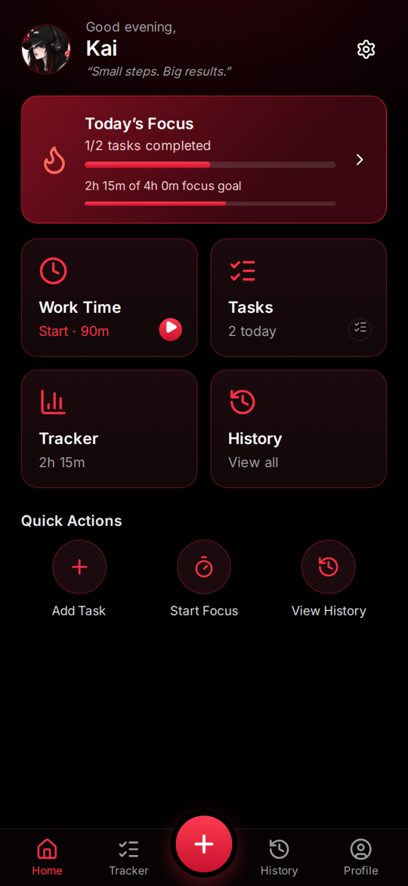
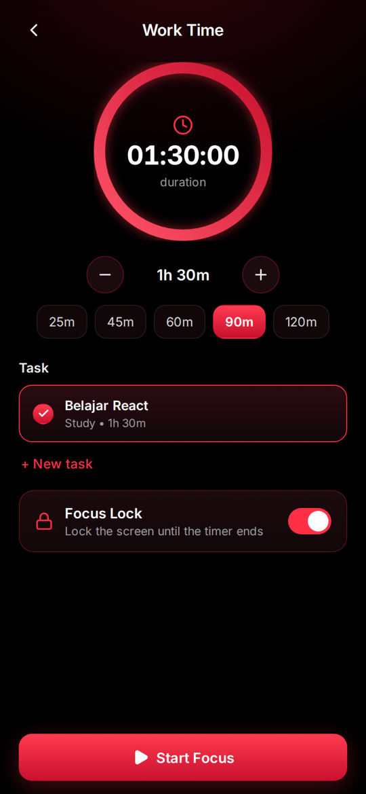
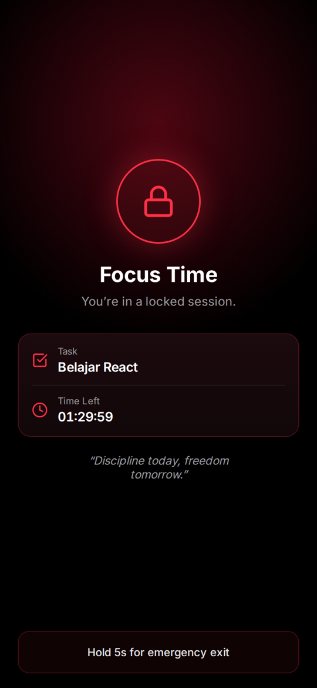
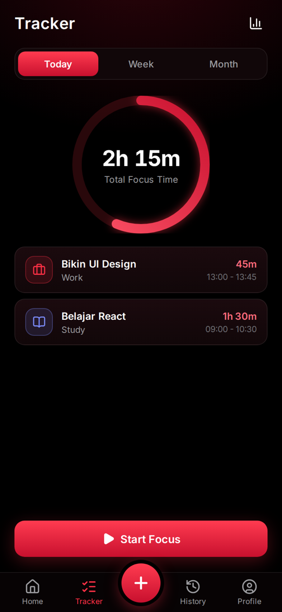
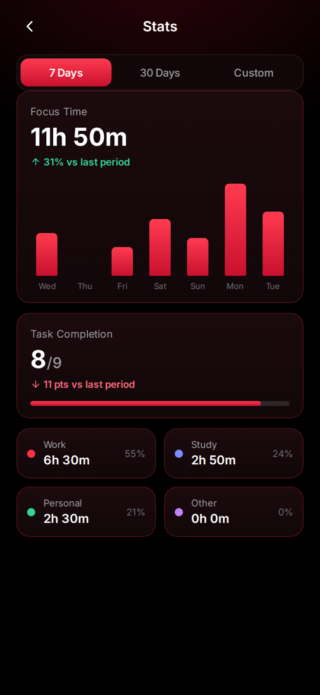

# LIBR — FocusForge

> Less scrolling. More progress.

A personal focus app for Android: pick a task, set a duration, and lock yourself into the session until the timer ends.
Built with React and wrapped as a native app with Capacitor. Everything is stored on the device, with no backend and no account.

**[Live demo](https://focusforge-libr.vercel.app/)** (web version; native features like screen pinning only work in the APK)

<p>
  
  
  
  
  
</p>

## Features

- **Work Time**: choose a task, set a duration (default 90 minutes), start. Pause and finish early are available when Focus Lock is off.
- **Focus Lock**: a locked session screen with the Android back button disabled and the screen kept on. Optional Android screen pinning blocks Home and Recents. Leaving early takes a 5-second hold on the emergency exit plus a confirmation, and the session is logged as cancelled.
- **Tasks**: today's to-do list with categories (Work, Study, Personal, Other), optional time targets such as `90m`, `1h30` or `2 hours`, and notes.
- **Tracker and History**: daily, weekly and monthly totals, a ring against a daily goal, category filters, per-item delete with undo, clear all.
- **Stats**: 7-day, 30-day and custom ranges, a bar chart, comparison with the previous period, session completion rate and time per category.
- **Export**: full JSON backup and CSV of sessions through the system share sheet.
- **Notifications**: a local notification when a session ends.

## Engineering notes

- **Timer accuracy**: the timer stores a start timestamp and accumulated pause time instead of counting ticks, so it stays correct when the app is backgrounded or the WebView is paused. A session that ended in the background is finalized the moment the app comes back.
- **State**: a small external store (`useSyncExternalStore`) persisted to `localStorage`. Statistics are derived from the session list, never stored separately.
- **Native bridge**: a custom Capacitor plugin (`android-plugin/ScreenPinPlugin.java`) wraps `startLockTask()` and `FLAG_KEEP_SCREEN_ON`. The CI patch script registers it in the generated Android project, so no Android project is committed.
- **CI**: GitHub Actions builds the web app, generates the Android project, icons and splash, builds a release APK and signs it.

Stack: React 19, Vite, Capacitor 8, Lucide icons, Inter (bundled).

## Run locally

```bash
npm install
npm run dev
```

## Build the APK

The workflow in `.github/workflows/build-apk.yml` runs on every push to `main` (or manually from the Actions tab) and uploads `FocusForge.apk` as an artifact.

By default the APK is signed with a throwaway key, so it installs but later builds can't update it in place. To keep a permanent signing key, create one and add three repository secrets (Settings → Secrets and variables → Actions):

```bash
keytool -genkeypair -keystore focusforge.keystore -alias focusforge -keyalg RSA -keysize 2048 -validity 36500
base64 -w0 focusforge.keystore   # macOS: base64 -i focusforge.keystore
```

| Secret | Value |
| --- | --- |
| `KEYSTORE_BASE64` | output of the base64 command |
| `KEYSTORE_PASSWORD` | the keystore and key password |
| `KEY_ALIAS` | `focusforge` |

Never commit the keystore. It is already in `.gitignore`.

## License

MIT
